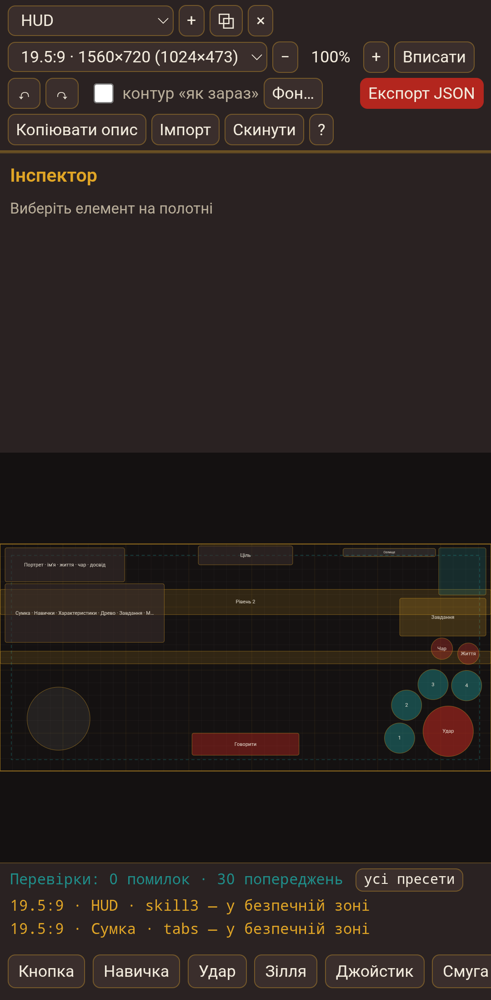

# Редактор розкладки UI

Один HTML-файл для розставляння кнопок і панелей гри «Спогади пращурів» на
полотні екрана. Без інтернету, без збірки, працює з телефона й з комп'ютера.

**Файл, який відкривають:** `index.html` (подвійний клік або «Відкрити з
браузером»).



## Як користуватись

1. Відкрий `index.html`.
2. Обери екран зверху: HUD, Сумка, Характеристики, Древо, Карта.
3. Обери співвідношення сторін — від нього залежить, як поводяться прив'язки.
4. Тягай елементи, змінюй розмір за ручки, прав в інспекторі числа й якір.
5. Дивись панель «Перевірки» внизу: що вилазить за екран, що замале для пальця,
   що перетинається.
6. **Експорт JSON** — файл `ui_layout.json` для передачі, **Копіювати опис** —
   текст для чату, **Імпорт** — відкрити чужий файл назад.

Кожна зміна сама зберігається в браузері; **Скинути** повертає шаблон.

## Що вміє

- П'ять готових екранів з поточної гри (шаблони наближені — прав їх як звичайні елементи).
- 17 типів деталей: кнопка, навичка, удар, зілля, джойстик, смуга, мінікарта,
  портрет, панель, слот, сітка, вкладки, скрол, напис, трекер, діалог, банер.
- Якір на кожен край (ліво/центр/право, верх/середина/низ) або «тягнеться» —
  панель може розтягуватись між двома краями.
- Кільце навичок: спільний радіус і кут кожної навички, як у `hud.gd`.
- Прилипання до країв, центрів і сусідніх елементів, сітка 40, безпечна зона 36.
- Мультивибір рамкою (`Shift` + тягання по порожньому) або `Shift`-кліком,
  вирівнювання (6 напрямів), рівні проміжки (⇹ X / ⇹ Y), дубль, копіювання між
  екранами, z-порядок, замок.
- Перевірки на всіх пресетах одразу (як у `tests/layout_regression.gd`).
- Контур «як зараз» — де був елемент до правок.
- Фон-скріншот з прозорістю (до 600 КБ вбудовується в JSON, важчий лишається в браузері).
- Undo/redo на 50 кроків.

## Гарячі клавіші

`←↑→↓` — зсув на 1, з `Shift` — на 8 · `Ctrl+D` — дубль · `Ctrl+C` / `Ctrl+V` —
копія й вставка · `Ctrl+Z` / `Ctrl+Shift+Z` — скасувати / повторити ·
`Delete` — видалити · `Esc` — зняти виділення · `Ctrl+S` — експорт ·
`Shift` + тягання по порожньому — рамка виділення ·
колесо — масштаб · тягання порожнього полотна — панорама.

## Формат `ui_layout.json`

```json
{
  "version": 1,
  "canvas": { "w": 1560, "h": 720 },
  "screens": [
    {
      "id": "hud",
      "title": "HUD",
      "elements": [
        { "id": "attack", "type": "attack", "text": "Удар",
          "a": { "l": "r", "t": "b", "r": "r", "b": "b" },
          "o": { "l": -216, "t": -206, "r": -56, "b": -46 },
          "ring": { "dist": 156, "angles": [172, 212, 252, 292] },
          "z": 5, "locked": false, "visible": true },
        { "id": "skill0", "type": "skill", "text": "1",
          "rel": { "parent": "attack", "angle": 172 },
          "o": { "l": 0, "t": 0, "r": 96, "b": 96 } }
      ]
    }
  ]
}
```

- `a` — якір кожного краю: `l`/`c`/`r` по X, `t`/`m`/`b` по Y.
- `o` — відступ краю від якоря в одиницях полотна.
- Фіксований розмір = лівий і правий край на одному якорі; тягнутий = на протилежних.
- `rel` — прив'язка до батька: `{parent, angle}` для кільця або
  `{parent, mode:"offset", dx, dy}`.
- `ring` — радіус кільця й кути навичок.

Полотно — **одиниці гри**, не фізичні пікселі: у Godot `canvas_items` + `expand`
висота завжди 720, ширина залежить від телефона (1024×473 → 1560×720).

## Обмеження

- У «Сумці», «Характеристиках» і «Древі» рухаються блоки (панель, сітка, колонка
  дій), а не кожна кнопка всередині: кнопки в контейнері не мають своєї позиції.
- Фон важчий за 600 КБ не потрапляє у файл — лишається в цьому браузері.
- Шаблони наближені до гри: точні розміри автор добирає руками.

## Тести

```bash
node tools/ui-layout-editor/test_model.js   # 70 перевірок моделі, без залежностей
```

`selftest.html` — димова перевірка інтерфейсу в браузері (тягання, undo, імпорт,
копіювання). Відкривається тим самим способом, що й редактор; на сторінці має
з'явитися «СЕЛФТЕСТ ПРОЙДЕНО».
